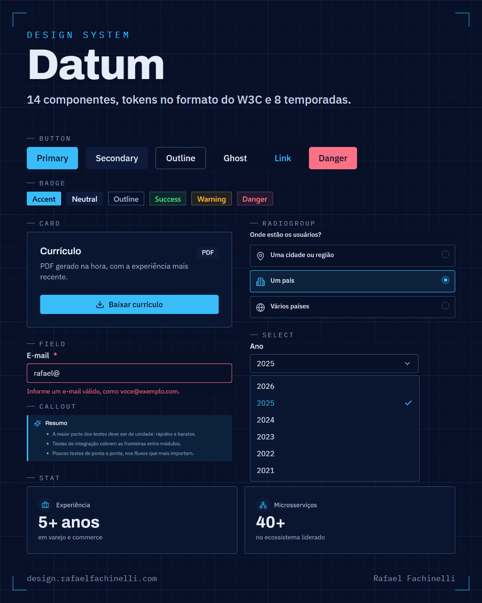

<p align="center">
  
</p>

<p align="center">
  
  
  <a href="https://rafaelfachinelli.com">
    
  </a>
  
</p>

<p align="center">
  <a href="https://design.rafaelfachinelli.com">Storybook</a> • <a href="https://rafaelfachinelli.com/en-US/articles/como-criei-o-datum-design-system">How it was made</a>
</p>

<p align="center">
  <a href="#eye_speech_bubble-preview">Preview</a> •
  <a href="#information_source-about">About</a> •
  <a href="#memo-tasks">Tasks</a> •
  <a href="#arrow_forward-run">Run</a> •
  <a href="#hammer_and_wrench-technologies">Technologies</a> •
  <a href="#boy-author">Author</a> •
  <a href="#balance_scale-license">License</a>
</p>

---

## :eye_speech_bubble: Preview

<div align="center">



</div>

---

## :information_source: About

📐 **Datum** is the design system of [rafaelfachinelli.com](https://rafaelfachinelli.com) and its tools. In technical drawing, the datum is the reference every dimension is measured from; here it is the reference for color, space and type, so every page fits.

- **Tokens** in the [W3C Design Tokens Community Group format](https://www.w3.org/community/reports/design-tokens/CG-FINAL-format-20251028/): palette, dark theme, type, a 4 px spacing scale and a 2 px radius. One build turns them into CSS variables, a Tailwind 4 theme and a typed module.
- **Eight seasons**: the accent and the logo colors change with the date (Carnival, Halloween, Christmas…), set before the first paint. Layout and contrast never change.
- **14 React components** (primitives and general patterns) on Radix and shadcn/ui, with the Blueprint personality on top: Button, Badge, Card, Field, Input, Select, RadioGroup, Sheet, Tooltip, Callout, Stat and more.
- **Rules in code**: every text and background pair passes WCAG AA (4.5:1) in every season, or the token tests fail the build.
- **Storybook** in Portuguese at [design.rafaelfachinelli.com](https://design.rafaelfachinelli.com): foundations, one story per state, accessibility checks with axe, and the release notes (Novidades).

The packages are being prepared for npm as `@rafaelfachinelli/datum-tokens` and `@rafaelfachinelli/datum-ui`. How Datum was made: [the article](https://rafaelfachinelli.com/pt-BR/articles/como-criei-o-datum-design-system) (Portuguese and English).

---

## :memo: Tasks

<div align="center">
<details>
<summary>Click to view</summary>

|State|Task|
|:---:|:---|
|:heavy_check_mark:|Tokens in the W3C format, built to CSS, Tailwind 4 and TypeScript|
|:heavy_check_mark:|Eight seasonal themes with WCAG AA contrast tests|
|:heavy_check_mark:|14 accessible React components|
|:heavy_check_mark:|Storybook with foundations, one story per state and release notes|
|:heavy_check_mark:|Used by rafaelfachinelli.com and its tools|
|:x:|Published on npm|

</details>
</div>

---

## :arrow_forward: Run

You need [Node.js](https://nodejs.org/) 20+.

```bash
# Install the workspace
npm install

# Storybook on http://localhost:6006
npm run dev

# Build the tokens, the components and the Storybook
npm run build

# Token tests (contrast and season dates)
npm test
```

<details>
<summary><b>Repository layout</b></summary>

|Path|What it is|
|:---|:---|
|`packages/tokens`|Design tokens, seasons and contrast tests|
|`packages/ui`|React components on the token theme|
|`apps/storybook`|The documentation site|
|`docs`|Rules of the design system and the brand principles|

</details>

---

## :hammer_and_wrench: Technologies

<div align="center">

|Tokens|Components|Docs|
|:---:|:---:|:---:|
|[W3C DTCG](https://www.designtokens.org/)|[React 19](https://react.dev/)|[Storybook 10](https://storybook.js.org/)|
|[TypeScript](https://www.typescriptlang.org/)|[Tailwind CSS 4](https://tailwindcss.com/)|[axe](https://github.com/dequelabs/axe-core)|
|[Vitest](https://vitest.dev/)|[Radix UI](https://www.radix-ui.com/)|[Turborepo](https://turborepo.com/)|
||[shadcn/ui](https://ui.shadcn.com/)||

</div>

---

## :boy: Author

<div align="center">

<a href="https://rafaelfachinelli.com">
  
  <br/>
  <sub><b>Rafael Fachinelli</b></sub>
</a>

Tech Lead and software engineer. Get in touch!

[](https://rafaelfachinelli.com)
[](https://www.linkedin.com/in/rafaelfachinelli/)
[](https://github.com/rafaelfachinelli)
[](mailto:contato@rafaelfachinelli.com)

</div>

---

## :balance_scale: License

This project is under the [MIT license](./LICENSE).

The license covers the code. The name **Datum**, the RF logo and the **Blueprint** visual identity (the drafting board and the seasonal themes as a brand) belong to Rafael Fachinelli and are not covered by it: use the components freely, and give your product its own name and look.
